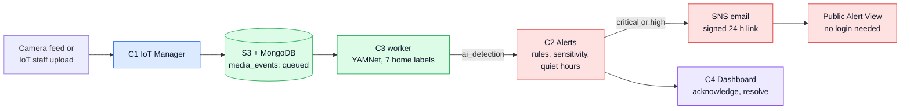

<div align="center">

# HomeAI Cloud

**Know when a home needs help, without watching every camera.**

A multi-tenant smart-home safety platform that turns short audio/video clips into classified events, rule-based alerts, and email escalation.


[The project](#the-project-at-a-glance) · [Problem](#the-problem) · [How it works](#how-it-works) · [Team](#team-and-contributions) · [Demo](#try-it-in-five-minutes) · [Run locally](#run-it-locally) · [Docs](#documentation)

</div>

> [!NOTE]
> **Status (Nov 2026):** The full path (clip, classify, alert, SNS email) runs on **AWS EC2** with real S3, SNS, Secrets Manager, and RDS. All four services, the React SPA, and the seed demos are on `main`.

---

## The project at a glance

|                          |                                                                                                                                                                                                                                                                                                                 |
| ------------------------ | --------------------------------------------------------------------------------------------------------------------------------------------------------------------------------------------------------------------------------------------------------------------------------------------------------------- |
| **What we are building** | A cloud platform where homes upload short audio/video clips from their camera feeds. Clips are classified with the pre-trained **YAMNet** model, alert rules turn detections into **alerts**, and **Amazon SNS** emails the house's emergency contacts. Owners acknowledge and resolve alerts in a web console. |
| **Who it is for**        | House owners and caregivers, IoT staff who keep feeds healthy, and cloud operators who run the platform.                                                                                                                                                                                                        |
| **Why it matters**       | Senior-care and multi-home operators get safety awareness without paying someone to watch every feed.                                                                                                                                                                                                           |
| **Team**                 | Four students, one component each (C1 to C4), one shared React app. See [Team and contributions](#team-and-contributions).                                                                                                                                                                                      |

---

## The problem

Senior-care and multi-home operators need to know about safety events (falls, smoke alarms, glass breaking, intrusion sounds) **without staffing someone to watch every camera feed**.

| Gap                                             | Why it hurts                                                       |
| ----------------------------------------------- | ------------------------------------------------------------------ |
| Many organizations and homes share one platform | Tenant A must never see Tenant B's data                            |
| Raw clips alone                                 | Caregivers need ranked, actionable alerts, not a wall of media     |
| Fragmented tools                                | Auth, settings, AI, rules, and email have to feel like one product |

**Who feels the pain**

- **House owners and caregivers:** Was there a real incident, and what should I do?
- **IoT staff:** Are the feeds online, and can I upload or test a clip?
- **Cloud operators:** Are the models, rules, tenants, and pipeline healthy?

**Our answer:** HomeAI turns short home clips into classified safety events, rule-based alerts, and email escalation, all behind a role-aware web console.

---

## How it works



<sub>Colors show which teammate's component owns each step: blue is C1, red is C2, green is C3, purple is C4.</sub>

1. **Register the home.** IoT staff set up houses, rooms, and camera feeds (C1).
2. **Upload a clip.** A device or IoT staff uploads a short clip for a feed. The file goes to **Amazon S3** and a queue row is created in MongoDB (`media_events`, status `queued`).
3. **Classify.** A C3 worker claims the clip, runs **YAMNet** on the audio, maps the output to a small set of **home safety labels**, and stores an `ai_detection`.
4. **Decide if it matters.** C2 evaluates **alert rules** (thresholds, severity, quiet hours, house settings from C4). A matching detection opens an **alert**.
5. **Notify people.** Emergency contacts get an **Amazon SNS** email with a signed, time-limited **Alert View** link. That public page needs no login.
6. **Act in the console.** Owners see the alert, play the clip, then acknowledge it, mark it a false positive, or resolve it.

<details>
<summary><b>Exactly when does an alert open?</b></summary>

<br>

When C3 finishes a detection it calls C2 `POST /alerts/evaluate`. C2 then:

- matches the label against tenant and house **alert rules**
- checks that confidence is at or above the effective threshold (shifted by the house **sensitivity** setting)
- skips the detection if the service is turned off or the room does not match
- suppresses medium and low severity during **quiet hours**

Critical and high alerts that match send an SNS email. Medium and low alerts stay in the app.

The full design is in [`docs/01_ARCHITECTURE.md`](docs/01_ARCHITECTURE.md).

</details>

---

## Team and contributions

Each teammate owns one component end to end: a FastAPI service, its database schema, and its pages in the shared React app.

|  Code  | Component                                                     | Owner                          | Service (port)                          | UI folder                                         |
| :----: | ------------------------------------------------------------- | ------------------------------ | --------------------------------------- | ------------------------------------------------- |
| **C1** | Home-Based IoT Device Manager                                 | **Ekant Kapgate**              | `services/c1_iot` (8001)                | `web/src/features/c1-iot`                         |
| **C2** | Alert Tracking and Monitor                                    | **Prathamesh Ravindra Sawant** | `services/c2_alerts` (8002)             | `web/src/features/c2-alerts`                      |
| **C3** | System Database Management, including AI inference            | **Renuka Prasad Patwari**      | `services/c3_data` (8003) + `c3-worker` | `web/src/features/c3-data`                        |
| **C4** | System Dashboard: auth, RBAC, settings, dashboards, app shell | **Mohit Manoj Barade**         | `services/c4_dashboard` (8004)          | `web/src/features/c4-dashboard`, `web/src/shared` |

### Ekant Kapgate, C1 IoT Device Manager

_The front door of the pipeline: homes, rooms, feeds, and clip ingest._

- **Delivered:**
  - Houses, rooms, and feeds management
  - Clip ingest to S3 with queue creation
  - Clip library with playback
  - Feed connectivity and stats
  - Seed data for demos
  - UI: Camera Feed Manager, Feed Detail, Houses and Rooms, Clip Library, My Feeds
  - Ran the EC2 and real-S3 demos
- **Wrapping up:** Playwright test `e2e/c1-feed-setup`, the formal integration check, and UI polish acceptance on EC2.

### Prathamesh Ravindra Sawant, C2 Alert Tracking

_Decides which detections matter and gets the right people told._

- **Delivered:**
  - Rules engine and the `evaluate` endpoint
  - Alert lifecycle (acknowledge, false positive, resolve)
  - SNS notifier and scheduled jobs
  - Signed, time-limited public Alert View
  - Alerts and Rules UI
  - C2 demo runbook and the EC2 SNS walkthrough
- **Wrapping up:** Playwright test `e2e/c2-alert-lifecycle` and the remaining acceptance checklist rows.

### Renuka Prasad Patwari, C3 Database and AI

_Turns audio into labeled detections and keeps the platform's data healthy._

- **Delivered:**
  - YAMNet worker that classifies queued clips
  - Model registry with activate and deployment
  - Test classify
  - Records, activity patterns, integrity checks, and data dictionary
  - S3 backup
  - Seven C3 pages wired into the app shell
- **Wrapping up:** EC2 worker scaling, Playwright test `e2e/c3-model-activate`, the demo video, and the remaining acceptance checks.

### Mohit Manoj Barade, C4 Dashboard, Auth, and AWS

_Everything users touch before and around the other three components._

- **Delivered:**
  - Auth with RS256 JWTs, JWKS, and account lockout
  - Service tokens and role-based access control
  - House settings and emergency contacts
  - Tenants and users
  - Dashboard summary
  - SPA shell and shared UI kit
  - Home, Ops, Settings, and Tenants UI
  - Login and landing page
  - AWS lead: EC2, RDS, S3, SNS, and Secrets Manager
- **Wrapping up:** Playwright test `e2e/c4-login-settings` and the remaining acceptance ticks.

### Shared by all four

- One contract for API conventions, JWT claims, enums, and payloads ([`docs/02_CONTRACTS.md`](docs/02_CONTRACTS.md))
- A shared Python library (`libs/homeai_common`) used by every service
- Cross-component pull request review: someone from another component approves every change

---

## What each user sees

One React app. Where you land after login depends on your role.

| Role            | Job to be done                                               | Lands on         | Typical pages                                                                          |
| --------------- | ------------------------------------------------------------ | ---------------- | -------------------------------------------------------------------------------------- |
| **House owner** | Monitor my home, act on alerts, manage contacts and settings | `/home/overview` | Overview, Alerts, Services and settings, My Feeds, Clip library                        |
| **IoT staff**   | Keep feeds healthy, upload and test clips                    | `/iot/feeds`     | Camera feeds, Houses and rooms, Clip library, Test classify                            |
| **Cloud staff** | Operate the platform                                         | `/ops/dashboard` | System dashboard, Tenants and users, Alert rules, Models, Records, Integrity, Activity |

There is also one **public** page, `/alert-view/:token`: a mobile-friendly alert summary opened from the email link, with no app shell and no login. Severity and status are always shown as **icon plus word**, never color alone.

<!--
Add screenshots here once they are in docs/images/ (login, ops dashboard, alerts, camera feeds, settings):

| Login | System dashboard |
| --- | --- |
|  |  |
-->

---

## Cloud technologies used

| Technology                 | What it does in HomeAI                                                                |
| -------------------------- | ------------------------------------------------------------------------------------- |
| **AWS EC2**                | Hosts the four services and the web app behind a Caddy reverse proxy (Docker Compose) |
| **AWS RDS PostgreSQL 16**  | Relational data, one schema per component                                             |
| **AWS S3**                 | Clip storage and backups                                                              |
| **AWS SNS**                | Emergency-contact email with signed links                                             |
| **AWS Secrets Manager**    | Runtime secrets, nothing in git                                                       |
| **MongoDB 7**              | The `media_events` queue that connects ingest to the classifier                       |
| **Multi-tenancy**          | Tenant isolation enforced in every service, tested with a second tenant               |
| **JWT (RS256) and JWKS**   | C4 issues tokens, every other service verifies them independently                     |
| **Queue and worker**       | Upload returns fast, classification runs asynchronously in `c3-worker`                |
| **Signed, expiring links** | Alert View works from email without exposing the console                              |

Locally, LocalStack stands in for S3, SNS, and Secrets Manager.

**Stack:** Python 3.11, FastAPI, Pydantic v2, SQLAlchemy 2, Alembic, PyMongo, APScheduler, TensorFlow (CPU) with TensorFlow Hub YAMNet, React 18, TypeScript, Vite, Tailwind CSS, React Router, TanStack Query, Recharts.

---

## Try it in five minutes

After [running locally](#run-it-locally), walk the whole pipeline with the seeded demo accounts:

1. **See the platform view.** Sign in at <http://localhost:8080> as `ops@homeai.test` and look at the system dashboard, alert rules, and models.
2. **Upload a clip.** Sign in as `iot@acme.test` and upload a clip from `demo_clips/` to a Maple St feed (or use the device simulator in `scripts/`).
3. **Watch it get classified.** Once the worker picks it up, the clip shows its top label in the Clip library.
4. **Handle the alert.** Sign in as `owner.maple@acme.test`. A matching detection has opened an alert. Acknowledge it, then resolve it.
5. **Check the email path.** For critical and high alerts, emergency contacts get the SNS email with a signed 24 h link (real SNS on the AWS deployment, LocalStack locally).
6. **Check tenant isolation.** Sign in as `owner.sun@sunrise.test`. You should see none of Acme Care's data.

### Demo accounts (local and dev only)

All seeded users share the dev password `Demo!2026`. It is never used on a shared deployment.

| Email                    | Role        | Scope                                                |
| ------------------------ | ----------- | ---------------------------------------------------- |
| `owner.maple@acme.test`  | house_owner | Maple St (Acme Care)                                 |
| `owner.oak@acme.test`    | house_owner | Oak Ave (Acme Care)                                  |
| `iot@acme.test`          | iot_staff   | Acme Care tenant                                     |
| `ops@homeai.test`        | cloud_staff | All tenants                                          |
| `owner.sun@sunrise.test` | house_owner | Pine Rd (Sunrise Living), for tenant-isolation tests |

---

## Run it locally

Prerequisites: Docker with the Compose plugin, Python 3.11, Node 20, GNU Make.

```bash
cp .env.example .env      # local defaults; never commit .env
make up                   # postgres, mongo, localstack, the four services, caddy
make migrate              # Alembic migrations for every service
make seed                 # demo tenants, users, houses, feeds, rules, model
make demo-clips           # download or generate demo audio into ./demo_clips
```

- App and API gateway: <http://localhost:8080>
- API docs: `http://localhost:8080/api/v1/docs/c1` through `/c4`
- Health: `http://localhost:8080/api/v1/health/c1` through `/c4`
- Frontend with hot reload: `make web` (Vite on <http://localhost:5173>, proxies `/api` to the gateway)

<details>
<summary><b>Common commands</b></summary>

<br>

| Command                       | What it does                                                   |
| ----------------------------- | -------------------------------------------------------------- |
| `make up` / `make down`       | Start or stop the local stack                                  |
| `make test` / `make test-c2`  | Run all tests, or one service's tests                          |
| `make lint`                   | ruff, eslint, and TypeScript type-check                        |
| `make token ROLE=house_owner` | Print a dev JWT for a seeded user                              |
| `make token CLIENT=c3-worker` | Print a dev service token                                      |
| `make reset-demo`             | Clear alerts, clips, and detections, then reseed (keeps users) |
| `make deploy`                 | Pull and rebuild on the EC2 host                               |

</details>

<details>
<summary><b>Repository layout</b></summary>

<br>

```
homeai-cloud/
├── AGENTS.md            # rules for AI coding assistants (read first)
├── docs/                # architecture, contracts, per-component plans
├── libs/homeai_common/  # shared Python library: auth, errors, pagination, logging, db, clients
├── services/            # c1_iot, c2_alerts, c3_data, c4_dashboard (FastAPI apps)
├── web/                 # React SPA
├── infra/               # docker-compose, Caddy, DB/Mongo init, LocalStack, AWS scripts
└── scripts/             # seed, token minting, device simulator, demo helpers
```

</details>

---

## Documentation

Read these in order:

1. [`AGENTS.md`](AGENTS.md): hard rules, stack, definition of done
2. [`docs/01_ARCHITECTURE.md`](docs/01_ARCHITECTURE.md): components, data ownership, clip-to-alert flow
3. [`docs/02_CONTRACTS.md`](docs/02_CONTRACTS.md): **binding** API conventions, JWT claims, enums, payloads
4. [`docs/03_REPO_AND_INFRA.md`](docs/03_REPO_AND_INFRA.md): repo layout, shared library, Docker, AWS, CI
5. [`docs/04_FRONTEND.md`](docs/04_FRONTEND.md): SPA structure, routes, shared UI kit
6. Component plans: [C1](docs/components/C1_IOT_DEVICE_MANAGER.md) · [C2](docs/components/C2_ALERT_TRACKING.md) · [C3](docs/components/C3_DATABASE_AND_AI.md) · [C4](docs/components/C4_DASHBOARD_AND_AUTH.md)
7. [`docs/05_INTEGRATION_AND_TESTING.md`](docs/05_INTEGRATION_AND_TESTING.md), [`docs/06_ROADMAP_AND_DEMO.md`](docs/06_ROADMAP_AND_DEMO.md), and [`docs/07_DEMO_NOV_11.md`](docs/07_DEMO_NOV_11.md) (demo priority until 11 Nov)
8. C2 live demo notes: [`docs/C2_DEMO_RUNBOOK.md`](docs/C2_DEMO_RUNBOOK.md)

Contract changes are recorded in [`docs/CHANGELOG.md`](docs/CHANGELOG.md).

## Contributing

- Branch from `main` and name branches `<component>/<topic>`, for example `c2/alert-rules-api`.
- Open a pull request. CI must be green and a member of another component must review it.
- Change only your own component's folders. Changes to `libs/homeai_common`, `web/src/shared`, `infra/`, or another component need that owner's review.
- No secrets in git. Configuration comes from environment variables; the template is `.env.example`.

## Credits

- **YAMNet:** Google, trained on [AudioSet](https://research.google.com/audioset/). Model via TensorFlow Hub (Apache 2.0).
- **ESC-50:** K. J. Piczak, _ESC: Dataset for Environmental Sound Classification_ (CC BY-NC 3.0). Used for demo and evaluation clips, academic use only.
