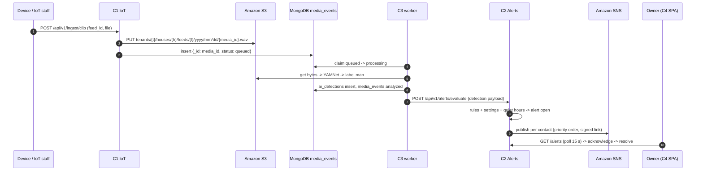
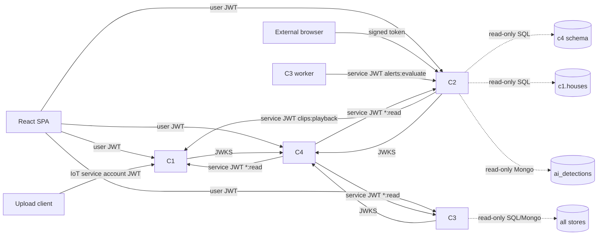
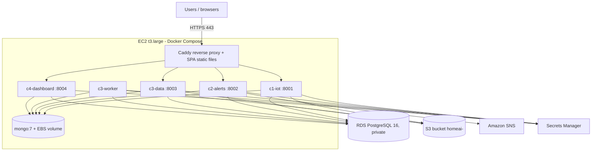

# 01 — Architecture

## 1. System in one paragraph
Tenants (e.g. a senior-care community) own **houses** with **rooms**. IoT staff register **camera feeds**
(software media sources) in rooms. A device or phone uploads short audio/video **clips** for a feed (C1).
The clip lands in S3 and in MongoDB `media_events` with status `queued`. The C3 **inference worker** claims
the clip, runs **YAMNet** on its audio, maps the 521 YAMNet classes to 7 **home labels**, stores an
**ai_detection**, and calls C2. C2 evaluates **alert rules** against the detection and the house's
**service settings** (C4), raises an **alert**, and emails **emergency contacts** through **Amazon SNS** with a
signed 24-hour link. Owners acknowledge/resolve alerts in the dashboard (C4 shell, C2 pages). C4 handles
login, JWTs, RBAC, settings, contacts and statistics dashboards.

## 2. Components and responsibilities
| | C1 IoT Device Manager | C2 Alert Tracking | C3 Database + AI | C4 Dashboard + Auth |
|---|---|---|---|---|
| Owns (PostgreSQL schema) | `c1`: houses, rooms, camera_feeds, feed_config_versions | `c2`: alert_types, alert_rules, alerts, alert_status_history, notifications | `c3`: ml_models, integrity_reports, data_dictionary_versions | `c4`: tenants, users, house_service_settings, emergency_contacts, service_clients, revoked_tokens |
| Owns (MongoDB) | `media_events` | — | `ai_detections`, `activity_patterns` | `dashboard_stats_daily` |
| Owns (AWS) | S3 clip objects | SNS topics/subscriptions, alert-view HMAC key | S3 model artifacts, backups | JWT signing keys |
| Service (port) | `c1-iot` (8001) | `c2-alerts` (8002) | `c3-data` (8003) + `c3-worker` | `c4-dashboard` (8004) |
| Scheduled jobs | ConnectivityMonitor (60 s) | NotificationRetry (60 s), ContactSubscriptionSync (5 min) | Worker loop (2 s), IntegrityRun (nightly + on demand), Backup (nightly) | StatsRollupJob (00:15 UTC), RevokedToken purge (hourly) |
| UI pages | Camera Feed Manager, Feed Detail, Houses & Rooms, Clip Library, My Feeds | Alerts list, Alert Detail, Alert Rules, public Alert View | Model Management, Test Classify, Database Records, Data Dictionary, Integrity, Activity | Login, App shell, Home Overview, Services & Settings, System Dashboard, Tenants & Users |

## 3. The clip-to-alert flow (steps 1–7)

## 4. Who calls whom

Rules: REST between services always carries a C4-issued JWT. Read-only DB access is used only where the
design says so (C2 → C4 settings/contacts and C1 houses timezone; C2 → C3 detections; C3 → everything for
record browsing and integrity). **No component writes another component's tables**, except C3 updating the
processing fields of `media_events` (documented exception).

## 5. Deployment topology (AWS, one region, e.g. us-west-2)

- One EC2 instance (Ubuntu 22.04, t3.large: 2 vCPU / 8 GiB — TensorFlow needs the memory) with an
  instance profile (IAM role); no static AWS keys anywhere.
- RDS in the same VPC, security group allows 5432 only from the EC2 security group.
- EC2 security group: 80/443 from anywhere, 22 from team IPs only.
- Caddy serves the built SPA and routes `/api/v1/*` to services (routing table in `03_REPO_AND_INFRA.md`).

## 6. Gateway routing (path prefix → service)
| Path (all under `/api/v1`) | Service |
|---|---|
| `/houses/{id}/settings`, `/houses/{id}/emergency-contacts*`, `/emergency-contacts/*` | **c4** (must be matched before `/houses`) |
| `/houses*`, `/rooms*`, `/feeds*`, `/ingest/*`, `/clips*` | c1 |
| `/alerts*`, `/alert-rules*`, `/alert-types*`, `/alert-view/*` | c2 |
| `/inference/*`, `/media-events/*`, `/models*`, `/records/*`, `/detections/*`, `/data-dictionary*`, `/integrity-checks*`, `/integrity-reports/*`, `/activity-patterns*` | c3 |
| `/auth/*`, `/dashboard/*`, `/tenants*`, `/users/*`, `/.well-known/jwks.json` (root, not under /api/v1) | c4 |
| `/api/v1/docs/{c1..c4}`, `/api/v1/health/{c1..c4}` | the named service |

## 7. Status vocabularies (canonical lists live in `02_CONTRACTS.md`)
- Feed: `provisioned → active ⇄ inactive`, any → `error`; `is_enabled` separate.
- Clip (`media_events.status`): `queued → processing → analyzed | failed`.
- Alert: `open → acknowledged → resolved`; `open|acknowledged → false_positive`.
- Notification: `queued → sent | failed` (retry ≤ 3).
- Session: unauthenticated → authenticated → expired / denied.
