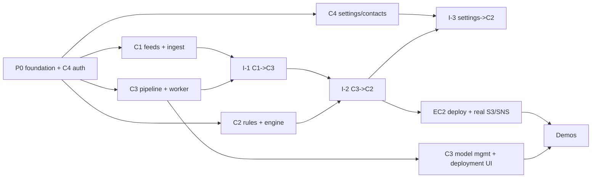

# 06 — Roadmap, demo guide and final project

Assumed calendar: start **Mon 2 Nov 2026**, component demos in **week 6 (from Mon 7 Dec)**. Shift every date
if the course gives a different demo date; keep the order. Task IDs refer to `03_REPO_AND_INFRA.md` §10 (P0-*)
and the component plans (C1-*, C2-*, C3-*, C4-*).

> **Course dates (added 12 Nov 2026).** The component demos (M5) took place on **Wed 11 Nov 2026**
> (`07_DEMO_NOV_11.md`). The **final project presentation is Wed 2 Dec 2026**, before the M4 freeze
> (Thu 3 Dec) and week 5 below: finish each component's remaining tasks and the §6 items by about
> **Sun 29 Nov** and keep 30 Nov–1 Dec for rehearsal. Order and scope are unchanged; each owner
> adjusts their own dates in §2.

## 1. Milestones
| Milestone | Date | Exit criteria |
|---|---|---|
| **M0 Foundation** | Sun 8 Nov | `make up` starts all containers healthy; login works; every service verifies a C4 token; CI green; seed users exist |
| **M1 Core APIs** | Sun 15 Nov | Each component's core CRUD/logic endpoints with API tests; demo clips available |
| **M2 Pipeline** | Sun 22 Nov | Upload → classify → alert works locally (I-1, I-2 pass); AWS account resources created |
| **M3 Feature complete + deployed** | Sun 29 Nov | All UI pages in each plan work; stack runs on EC2 with real S3/SNS; I-3…I-7 pass on EC2 |
| **M4 Demo ready** | Thu 3 Dec (code freeze 9 pm) | Playwright rehearsal specs green; demo scripts rehearsed twice; videos recorded by Sat 5 Dec |
| **M5 Component demos** | week of 7 Dec | Live demos + uploaded videos |
| **M6 Final project** | after demos (date TBA) | E2E-1, I-8, performance report, polish, final report |

## 2. Week-by-week plan per member
| Week | Ekant (C1) | Prathamesh (C2) | Renuka (C3) | Mohit (C4) |
|---|---|---|---|---|
| **1** · 2–8 Nov | P0-10 seed skeleton, C1-01 | P0-3 common lib, P0-11 CI, C2-01 | P0-5 compose/infra, P0-9 Caddy, P0-12 clips, C3-01 (TF image!) | P0-1, P0-2, P0-4, P0-7, P0-8 = C4-01…C4-05, C4-10 |
| **2** · 9–15 Nov | C1-02 … C1-05 | C2-02 … C2-05 | C3-02 … C3-05 | C4-06, C4-07, C4-11, C4-15 |
| **3** · 16–22 Nov | C1-06 … C1-10 | C2-06 … C2-09, C2-12 | C3-06 … C3-08 | C4-08, C4-09, C4-12, **C4-16 AWS setup** (all help 1 evening) |
| **4** · 23–29 Nov (Thanksgiving Thu) | C1-11 … C1-13; deploy | C2-10, C2-11, C2-13 … C2-15; deploy | C3-09 … C3-14, start C3-15/C3-17 | C4-13, C4-14; deploy; I-5 |
| **5** · 30 Nov–6 Dec | C1-14, C1-15, video | C2-16, C2-17, video | C3-15 … C3-20, video | C4-17, video; demo-day logistics |
| **6** · from 7 Dec | Live demo | Live demo | Live demo | Live demo |
Weekly rhythm: Monday 30-min planning (move board cards), Thursday integration session (run `make test-integration`
together, fix contract issues), PRs reviewed within 24 h by a member of another component.

## 3. Critical path and dependencies

Every component has a **stub** (in its plan, §1.1) so nobody waits: C3 can enqueue its own clips, C2 can fake
detections, C4 dashboards tolerate missing sources, C1 needs only login.

## 4. How each demo earns the points
| Rubric | Points | What every member shows |
|---|---|---|
| Component live demo | 3 | (a) every required function of the component through **its UI**; (b) the **backend** evidence: Swagger, a DB/S3/SNS view, logs; (c) business-rule edge cases from the D2 decision tables; (d) **unit tests running**; (e) it runs on **AWS EC2** |
| Scenario video | 2 | One realistic story (script in each plan §10.2), narrated, 5–7 min, showing UI + required functions |
| AI component (C3) | — | Model management UI (versions, label map, evaluation, activation, rollback) and deployment (containers, workers, live switch) |

### 4.1 Live demo structure (7–8 minutes)
| Time | Segment |
|---|---|
| 0:00–0:30 | Where the component sits (architecture slide from D2), what it owns |
| 0:30–4:30 | Main functions through the UI (plan §10.1 steps) |
| 4:30–5:45 | Edge cases and rules (409/422 paths, quiet hours, lockout, retries…) |
| 5:45–6:45 | Backend proof: Swagger, AWS console (S3 object / SNS email / RDS via Records), logs |
| 6:45–7:30 | `make test-cx` run + coverage; deployment view (`docker compose ps` on EC2) |
| 7:30–8:00 | Questions |

### 4.2 Recording the scenario video
- Tools: OBS Studio (free) or QuickTime/Windows Game Bar; 1920×1080, 30 fps; external mic if possible.
- Before recording: `make reset-demo` on EC2, log out all sessions, close notifications, zoom browser to 110%.
- Structure: 10 s title card (name, component, course) → story (plan §10.2) with voice-over → 20 s closing summary.
- Show the EC2 URL in the address bar at least once; show one backend view (Swagger or AWS console).
- Keep it ≤ 7 minutes; export MP4 (H.264); upload where the course asks (Canvas / unlisted YouTube) and test the link.
- Rehearse with the Playwright spec first; record twice and keep the better take.

### 4.3 Demo-day checklist
Day before: EC2 + RDS started, `make deploy` from the freeze tag, `make reset-demo`, SNS subscriptions confirmed,
demo clips on the presenting laptop, passwords in a sticky note (not in slides), backup local stack tested,
videos uploaded. One hour before: health page for all four services green, one full rehearsal of your script,
phone ready for the email/alert-view step (C2), C3 model warmed (run Test Classify once).

## 5. Risk register
| Risk | Impact | Mitigation | Owner |
|---|---|---|---|
| TensorFlow image is large/slow to build; EC2 memory | C3 blocked | Build image in week 1; `tensorflow-cpu`; `t3.large`; build on EC2 once and cache | Renuka |
| SNS email subscriptions need manual confirmation | Emails not received in demo | Subscription sync job + confirm in week 5; `NOTIFIER=log` fallback; DEMO_MODE shows links in Alert Detail | Prathamesh |
| Cross-component contract drift | Integration breaks late | `homeai_common.contracts` + contract tests + weekly integration session | all |
| A component lags | Others' demos depend on it | Stubs per plan §1.1; each demo can run with only C4 login | all |
| AWS cost / account limits | Budget overrun | $25 budget alarm, stop EC2/RDS when idle, delete after grading | Mohit |
| Time zones (quiet hours) | Wrong suppression | Store house timezone (C1), unit tests incl. wrap-around and DST | Prathamesh |
| Network failure on demo day | Live demo fails | Local Docker stack with same seed + recorded video as fallback | all |
| Secrets leak | Account compromise | No keys in git; IAM role on EC2; Secrets Manager; `gitleaks` in CI | Mohit |

## 6. Final project (after component demos)
- [ ] E2E-1 passes on EC2 (automated test + UI spec) and is demoed as the group scenario.
- [ ] I-1 … I-8 pass on EC2; perf report (`05` §7) in `docs/RESULTS.md` closes TBD-3 and TBD-5.
- [ ] HTTPS with a domain; CloudWatch logs; nightly backups verified with a restore drill.
- [ ] Accessibility pass (keyboard-only walk-through of each page) and UI polish.
- [ ] README with architecture, setup, demo accounts, and credits for datasets (ESC-50, YAMNet/AudioSet).
- [ ] Final report: update D2 design where implementation changed (list from `docs/CHANGELOG.md`).
- [ ] Tear down AWS resources after grading.
