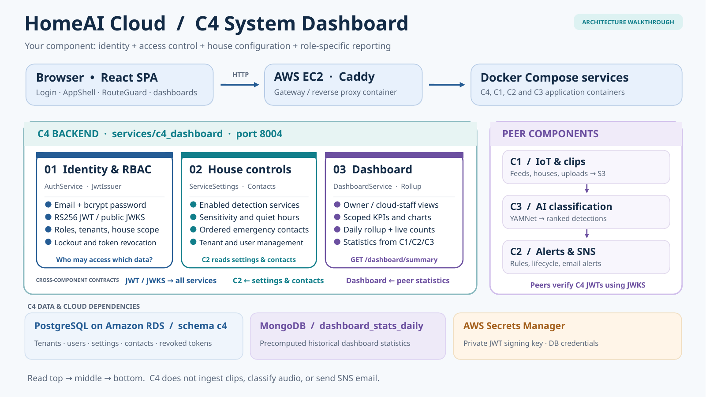

# C4 live demo runbook — Mohit (≈ 7–8 minutes)

**Understand the project first:** [`mohit/C4_AND_PROJECT_EXPLAINED.md`](../mohit/C4_AND_PROJECT_EXPLAINED.md)  
**This file:** what to **say** and what to **click**, including a one-minute walkthrough of your C4 architecture diagram. Keep it simple. Satisfy the live-demo rubric (UI + backend + unit tests on EC2). Scenario **video** is separate (§6).

**URL** http://44.226.166.194  
**Password** `Demo!2026` for all seed users  
**Swagger** http://44.226.166.194/api/v1/docs/c4  
**JWKS** http://44.226.166.194/.well-known/jwks.json  

| Account | Role | Use |
|---|---|---|
| `ops@homeai.test` | cloud_staff | Ops dashboard, tenants |
| `owner.maple@acme.test` | house_owner | Home + settings |
| `iot@acme.test` | iot_staff | Third landing only |
| `owner.sun@sunrise.test` | house_owner | Lockout only |

**Tabs before you start:** (0) `C4_ARCHITECTURE.pptx` in presentation mode · (1) login private window · (2) ops already logged in optional · (3) JWKS · (4) jwt.io · (5) Swagger C4 · (6) laptop terminal for `make test-c4` · (7) EC2 SSH for `docker compose … ps`. Zoom 110%. Do **not** redeploy during the slot.

---

## 0. Prep checklist (day of, 30–60 min before)

| | Check |
|---|---|
| ☐ | `curl http://44.226.166.194/api/v1/health/c4` → ok |
| ☐ | Logins work for ops, maple, iot, sun |
| ☐ | Maple **Services & settings**: wellness on, quiet hours 22:00–07:00, sensitivity medium, 3 contacts |
| ☐ | Laptop: `make test-c4` green once |
| ☐ | EC2: all containers up (`caddy`, `c4-dashboard`, c1/c2/c3…) |
| ☐ | `C4_ARCHITECTURE.pptx` or `C4_ARCHITECTURE.png` opens correctly in full-screen view |
| ☐ | Rehearse this script **twice** with a timer |

---

## 1. Live talk script (7–8 min)

Say the **Talk** lines out loud. Do the **Do** actions at the same time. Skip anything marked *if time*.

### Block A — C4 architecture walkthrough (0:00–1:15)

**Do:** Open **`C4_ARCHITECTURE.pptx`** full-screen on your laptop (or open the PNG). Point to each part in this order: **top row → C4 backend → C1/C3/C2 → data stores**. Then switch to the HomeAI login tab.

**Talk (about 60–70 seconds, natural pace):**
> HomeAI is a smart-home safety platform that turns uploaded recordings into useful alerts. Before I show the features, here's how my C4 component fits into the system. **At the top**, users interact with our React application. Requests pass through Caddy, which runs alongside our services in Docker on AWS EC2. **In the center**, C4 has three responsibilities. First is **identity and access**: login, bcrypt password checks, RS256 JWT tokens, JWKS public keys, and role permissions. Second is **house configuration**: enabled services, quiet hours, sensitivity, and emergency contacts. Third is **dashboards**: role-specific views built from historical daily statistics and live counts. **On the right**, C1 receives clips, C3 classifies sounds using YAMNet, and C2 evaluates alert rules and sends emails using SNS. These components verify my JWTs; C2 reads my house settings and contacts, while my dashboard reads statistics from C1, C2 and C3. **At the bottom**, C4 uses PostgreSQL for accounts and settings, MongoDB for dashboard rollups, and AWS Secrets Manager for private signing keys. So my component provides secure access, configuration and visibility, rather than doing AI inference or sending alert emails.

**Remember if asked:** This diagram reflects the **implemented EC2 + Caddy deployment** described in the project notes. The PDF's broader target architecture also mentions ALB and CloudFront; do not claim those are in the live deployment unless they were actually deployed.

**Three connections to point out if the professor interrupts:**
- **C4 → C1/C2/C3:** C4 issues JWTs; the services verify signatures using C4's JWKS public keys.
- **C2 → C4-owned data:** C2 reads enabled services, sensitivity, quiet hours and ordered contacts through read-only database access.
- **C4 dashboard ← C1/C2/C3:** It gathers alert, feed and detection counts and combines them with daily rollups.

**If the Markdown image is missing:** Open `C4_ARCHITECTURE.png` directly, or present `C4_ARCHITECTURE.pptx`. Keep the diagram beside the runbook when you download the files.

---

### Block B — Three roles + RBAC (1:15–2:20)

**Talk:**
> Three roles, three landings. Cloud staff see the system dashboard. IoT staff see feeds. House owners see the home overview. Route guards block cross-role URLs.

**Do:**
1. Login `ops@homeai.test` → land on **System dashboard**. Point at ops nav.
2. Logout → login `iot@acme.test` → land on **Camera feeds**.
3. Logout → login `owner.maple@acme.test` → land on **Home overview**.
4. In the address bar paste `/ops/dashboard` → Enter → bounced back to `/home/overview`.

---

### Block C — Backend proof: JWT + JWKS (2:20–3:05)

**Talk:**
> After login the SPA holds an RS256 JWT. Claims carry role, tenant, and house_ids. Services fetch my public JWKS to verify the signature — that is how auth is shared without sharing the private key.

**Do:**
1. DevTools → Application → Session Storage → `homeai.token` → copy (or copy Authorization from any Network request).
2. Open JWKS tab → show the public key JSON.
3. Paste token into jwt.io → point at `role`, `tenant_id`, `house_ids`, `exp`.

---

### Block D — Settings + contacts (3:05–4:40) — **core UI**

**Talk:**
> Owners configure which safety services are on, quiet hours, sensitivity, and who gets emailed. C2 reads these when it evaluates a detection — quiet hours suppress low and medium alerts, while critical and high alerts bypass quiet hours. Contact order determines email priority.

**Do:**
1. Still as Maple → **Services & settings**.
2. Toggle **Wellness** off → set sensitivity **High** → Save. (Quiet hours can stay 22:00–07:00; mention them.)
3. **Add** a contact (your email, type neighbor) → Save.
4. Add the **same email again** → show duplicate / 409 toast.
5. Drag to **reorder** contacts → Save. Say: “Priority order is what SNS uses.”

*Do not* run a live C2 cough/glass-break here unless you have spare time — that is Prathamesh’s demo. One sentence is enough.

---

### Block E — Dashboards (4:40–5:40)

**Talk:**
> Home overview is the owner scoreboard — open alerts and house health. System dashboard is for cloud staff across tenants, with filters. If a dependency is down, we show an unavailable warning and keep the rest of the page usable.

**Do:**
1. **Home overview** — point at KPI tiles / open alerts.
2. Logout → `ops@homeai.test` → **System dashboard**.
3. Filter tenant **Acme** (and Maple if listed), range **24h** or **7d** — point at charts / recent alerts.

*Skip stopping C3 live* unless rehearsal was rock solid; verbally: “Summary marks C1/C2/C3 unavailable instead of failing the whole page.”

---

### Block F — One security edge case (5:40–6:25)

Pick **one** (lockout is clearer on camera):

**Option 1 — Lockout (preferred)**  
**Talk:** Five failed logins within 15 minutes lock the account for 15 minutes; ops can unlock.  
**Do:** Private window → `owner.sun@sunrise.test` → wrong password 5× → locked countdown. Ops tab → **Tenants & users** → Sunrise → **Unlock**. (Correct login optional if time.)

**Option 2 — Logout revoke**  
**Talk:** Logout puts the token jti on the revocation list.  
**Do:** Maple logout → Swagger Authorize with **old** token → `GET /auth/me` → 401.

---

### Block G — Unit demo + deployment (6:25–7:30)

**Talk:**
> Component unit tests for C4, and the same build running on our EC2 host behind Caddy.

**Do:**
1. Laptop terminal: `make test-c4` → show green pass.
2. Flash Swagger `/api/v1/docs/c4` (login / settings / dashboard endpoints).
3. EC2:  
   `docker compose -f infra/docker-compose.yml -f infra/docker-compose.prod.yml --profile gateway --profile c3 --profile c1 ps`  
   → point at `c4-dashboard` and `caddy` healthy.

**Talk (close):**
> That is C4: authenticate everyone, enforce roles, let owners configure services and contacts, and give each role a dashboard — on AWS with tests green. I also have a **separate scenario video** — “A family member sets up their parent's home” — that walks through the owner setup story end to end; that is the scenario-demo submission, not this live slot.

**7:30–8:00** Questions.

---

## 2. What you are proving (rubric checklist)

| Rubric need | Where you showed it |
|---|---|
| Required functions + UI | Roles/RBAC, settings, contacts, home + ops dashboards, lockout or revoke |
| Backend | JWKS + jwt.io claims; Swagger C4 |
| Unit demo | `make test-c4` |
| On AWS EC2 | URL in address bar; `docker compose … ps` |

---

## 3. If something breaks

| Problem | Fallback |
|---|---|
| Site down | EC2 instance running? then `up -d` from prep |
| Lockout on wrong user | Only use `owner.sun`; never lock ops mid-demo |
| Settings 403 | Confirm Maple owner + house selected |
| Duplicate contact silent | Use a fresh email |
| `make test-c4` slow | Show a pre-recorded terminal scroll / prior green run, then Swagger |
| Empty dashboard | Still show filters + layout; say rollup fills charts overnight |

**After demo:** Restore Maple wellness **on**, sensitivity **medium**, remove your 4th contact if added.

---

## 4. Do **not** do in the live 8 minutes

- Full C1 upload → C3 → C2 → email path (Prathamesh / group)  
- Creating a new tenant + user (slow; skip unless asked)  
- Stopping C3 containers live  
- Service-token deep dive (one Swagger call only if a question asks)  
- AI model management (Renuka / C3)

---

## 5. Hand-off with Prathamesh

You show **settings + contacts**. He shows **rules → alert → SNS → Alert View**.  
Leave Maple settings in a known state if he goes after you. His script: [`C2_DEMO_RUNBOOK.md`](C2_DEMO_RUNBOOK.md).

---

## 6. Scenario video (2 pts — record separately, ≈ 5 min)

This is **not** the live class talk. Record once, upload where the course asks (Canvas / unlisted YouTube), and keep the link ready. In the live demo closing you already say you have this separate video.

**Title:** A family member sets up their parent's home  
**Target length:** 4:30–5:30 (hard max 7:00) · **Format:** MP4, 1080p if possible · **URL on screen:** http://44.226.166.194  

### 6.1 Before you hit Record

| | Prep |
|---|---|
| ☐ | EC2 up; login works for `owner.maple@acme.test` and `ops@homeai.test` (`Demo!2026`) |
| ☐ | Maple settings restored: wellness **on**, quiet hours **22:00–07:00**, sensitivity **medium**, only the 3 seed contacts (Alice → Bob → Carol) |
| ☐ | Logged out everywhere; notifications off; browser zoom 110%; bookmarks bar hidden if cluttered |
| ☐ | Address bar visible so EC2 URL shows once |
| ☐ | Title card ready (slide or full-screen text): your name · C4 System Dashboard / Auth · HomeAI Cloud · CMPE 281 · Fall 2026 |
| ☐ | Mic check; rehearse narration once without recording |

### 6.2 Shot list + narration (say / do)

Use OBS / QuickTime. Narrate while clicking. Timings are guides — stay under 7 minutes.

---

**0:00–0:15 · Title card**

**Say:**
> This is the C4 scenario demo for HomeAI Cloud, CMPE 281. I am Mohit Barade. Scenario: a family member sets up their parent's home on the cloud dashboard.

**Do:** Show title card 10–15 s. No UI yet.

---

**0:15–0:50 · Story setup + login (show EC2 URL)**

**Say:**
> In this story, I am the adult child helping set up monitoring for my parent's house — Maple Street under the Acme tenant. HomeAI is running on our AWS EC2 demo host. I sign in as the house owner.

**Do:**
1. Open http://44.226.166.194/login — pause so the **URL is readable**.
2. Email `owner.maple@acme.test` · password `Demo!2026` · Sign in.
3. Land on **Home overview**.

---

**0:50–1:40 · Home overview**

**Say:**
> Home overview is the owner's daily view: open alerts, feed health, and activity for the houses I am allowed to see. C4 owns this dashboard and the app shell around it. From here I go to Services and settings to configure the house.

**Do:**
1. Slowly pan KPI tiles / open alerts / any feed summary (do not click into C2 alert detail — stay on C4).
2. Click **Services & settings** in the nav.

---

**1:40–3:20 · Services, quiet hours, sensitivity**

**Say:**
> Here I choose which safety services are enabled for this house — fire, distress, intrusion, fall, wellness, and so on. I set quiet hours so low-priority wellness alerts do not wake the family overnight, and I set sensitivity. Alert Tracking — C2 — reads these settings when it decides whether to raise an alert. I am not sending the email from C4; I am defining the policy.

**Do:**
1. Point at the service toggles; turn **Wellness** off, then **back on** (shows control without leaving a bad state) — or turn off once and leave it if you will restore after recording.
2. Set quiet hours **22:00** – **07:00** (or show they are already set).
3. Change sensitivity **Medium → High** → **Save**.
4. Pause on the saved state.

*Recommended for a clean take:* end the video with sensitivity High and wellness on; restore medium after export. Or change High → Medium again before the next scene so seed stays clean.

---

**3:20–4:30 · Emergency contacts**

**Say:**
> Next I manage emergency contacts — who gets notified, and in what order. Priority one is family, then caregiver, then neighbor. C2 emails them through Amazon SNS in this order when a serious alert fires. I will add a contact and reorder the list.

**Do:**
1. **Add** contact: name e.g. `Dana Family`, your email, type **family** or **neighbor** → Save.
2. Briefly try duplicate email → show error/toast → dismiss / delete the failed attempt narrative.
3. **Drag** (or keyboard) to reorder so the new contact is not priority 1 if you prefer Alice first → **Save**.
4. Point at the ordered list: “This is the escalation order.”

---

**4:30–5:10 · Ops dashboard (cloud staff cut)**

**Say:**
> Zooming out: cloud operations staff use the system dashboard across tenants and houses. Same product, different role — C4 enforces that with RBAC. Filters let ops focus on one community or one home.

**Do:**
1. Logout → login `ops@homeai.test`.
2. **System dashboard** — filter Acme / Maple if available, range 24h or 7d.
3. Point at KPIs / charts / recent alerts for ~20 s. Do not deep-dive C3 pages.

---

**5:10–5:40 · Backend proof (one shot)**

**Say:**
> Backend side: C4 exposes OpenAPI docs and a public JWKS so every service can verify the tokens I issue.

**Do:** Open either:
- http://44.226.166.194/api/v1/docs/c4 — scroll login / settings endpoints, **or**
- http://44.226.166.194/.well-known/jwks.json — show the key JSON  

One of these is enough.

---

**5:40–6:00 · Closing card**

**Say:**
> That completes the C4 scenario: an owner configures the parent's home — services, quiet hours, sensitivity, and emergency contacts — and ops can monitor the fleet from the system dashboard. Thank you.

**Do:** Closing slide or freeze on dashboard + fade. Stop recording.

---

### 6.3 After recording

| | Step |
|---|---|
| ☐ | Watch the take once; re-record if URL never appeared or audio is bad |
| ☐ | Export MP4 (H.264), ≤ 7 minutes |
| ☐ | Upload (Canvas / unlisted YouTube); test the link in a private window |
| ☐ | Restore Maple: wellness on, sensitivity medium, quiet hours 22:00–07:00, remove extra contact if you added one |
| ☐ | Keep the link next to this runbook for submission day |

### 6.4 What this video must prove (scenario rubric)

| Need | Covered in |
|---|---|
| Required C4 functions + UI | Login, home overview, settings, contacts, ops dashboard |
| Clear scenario story | Family member sets up parent's home |
| Backend glimpse | Swagger **or** JWKS once |
| On AWS | EC2 URL visible in the address bar |

---

## 7. Submission reminder

| Deliverable | Where | Points |
|---|---|---|
| **Live component demo** | In class — §1 talk script | 3 |
| **Scenario video** | Uploaded recording — §6 (separate from live) | 2 |

**Say at the end of the live demo (already in Block G):** you have a **separate video** for the scenario “A family member sets up their parent's home.” Do not try to play the full video inside the 8-minute live slot unless Jerry asks.
