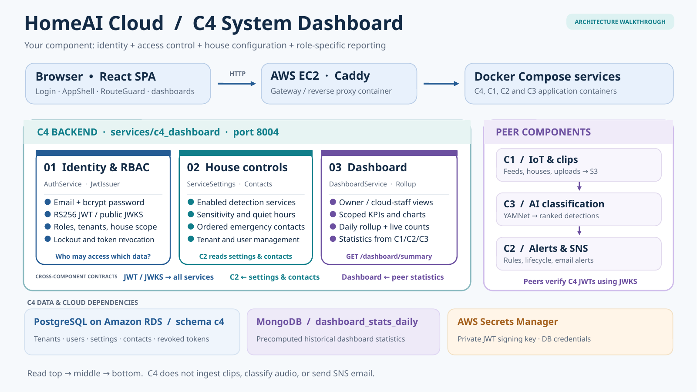

# HomeAI Cloud — C4 Complete Word-for-Word Demo Runbook

**Component:** C4 — System Dashboard, Authentication and Configuration  
**Course:** CMPE 281 Cloud Technologies  
**Live component demo:** about 7–8 minutes  
**Separate scenario recording:** about 5–6 minutes, no more than 7 minutes per supplied runbook  
**Purpose:** Every planned spoken word is under **SAY EXACTLY**. Everything under **DO (SILENT)** is an on-screen action, not something to read aloud. No improvisation is needed for the normal successful demo.

This is an expanded version of the attached C4 demo runbook. It follows the same C4 architecture, API boundaries, AWS deployment notes and scenario. Timings are rehearsal targets, not guarantees. Read at a medium pace, click while speaking, and adjust only the pace or number of pauses to fit your allocated slot.

> **Verification note:** The component PDF describes a design; the accompanying runbook describes an implementation. Verify the live features, endpoint availability, test outcomes and seed data before claiming they work. Do not say the test suite passed unless it actually did. Your documented public demo endpoint uses HTTP; don't claim the external site uses HTTPS unless verified.

## Demo environment and preparation (not spoken)

| Item | Value |
|---|---|
| Demo site | `http://44.226.166.194` |
| C4 Swagger | `http://44.226.166.194/api/v1/docs/c4` |
| C4 public JWKS | `http://44.226.166.194/.well-known/jwks.json` |
| Health check | `http://44.226.166.194/api/v1/health/c4` |
| Cloud staff account | `ops@homeai.test` |
| IoT staff account | `iot@acme.test` |
| House owner account | `owner.maple@acme.test` |
| Dedicated lockout-test account | `owner.sun@sunrise.test` |
| Seed demo password (do not read aloud) | `Demo!2026` |

Before the live demo: confirm the EC2 host and C4 health endpoint respond; verify login for all required roles; open the architecture PowerPoint, login page, Swagger, JWKS and terminal tabs; check that Maple has wellness enabled, medium sensitivity, quiet hours 22:00–07:00 and three seed contacts; run the C4 test suite once; and verify Docker containers. Set browser zoom to a readable level. Do not redeploy during the presentation.

For the JWT illustration, **prefer a previously prepared, redacted example of decoded token claims or a trusted local decoder**. Do not paste a working bearer token into an unrelated third-party website. The live JWKS endpoint contains *public* verification keys and is fine to display.

Keep `C4_ARCHITECTURE.png` in the same folder as this Markdown file, or use `C4_ARCHITECTURE.pptx` directly:



---

# DEMO 1 — LIVE COMPONENT DEMONSTRATION (approximately 7–8 minutes)

This is the technical demo: architecture → roles → backend authentication → settings and contacts → dashboards → security → tests and EC2.

## A. Architecture walkthrough | 0:00–1:05

**DO (SILENT):** Display `C4_ARCHITECTURE.pptx` in full-screen mode. Point at the browser/Caddy layer, C4 services, the connected C1/C3/C2 components, and the data stores in that order. Move to the login page as the last sentence finishes.

**SAY EXACTLY:**

> “I am presenting C4, the System Dashboard component of HomeAI Cloud. HomeAI Cloud is a smart-home safety platform. A recording enters through C1, C3 analyzes its sounds using YAMNet, and C2 decides whether the detection should raise an alert. My component is C4, the identity, configuration, and dashboard layer. At the top of this diagram is our React application. Its requests reach our Docker services on AWS EC2 through Caddy. In the middle, C4 handles login, JWT security, user roles, house settings, emergency contacts, and dashboards. Other services verify the tokens issued by C4. C2 also reads C4's settings and contact information, while my dashboard reads statistics from the other components. At the bottom, PostgreSQL stores accounts and configuration, MongoDB stores daily dashboard statistics, and AWS Secrets Manager holds signing keys and credentials. Now I'll show those responsibilities in the application.”

## B. Three roles and RBAC | 1:05–2:20

**DO (SILENT):** Login as `ops@homeai.test`. Show the system dashboard. Logout and login as `iot@acme.test`. Show the camera-feed landing page. Logout and login as `owner.maple@acme.test`. Show the home overview. Finally type `/ops/dashboard` in the browser address bar while signed in as the owner; show that the route is blocked or redirects.

**SAY EXACTLY (one sentence group per action):**

1. **Cloud staff login:**
   > “First, I am signing in as cloud staff. This role works across tenants and opens the System Dashboard, where operational metrics and management tools are available.”
2. **IoT staff login:**
   > “Next is the IoT staff role. It lands in the Camera Feed Manager, because its responsibility is managing houses, rooms, feeds, and uploaded clips within its tenant.”
3. **House owner login:**
   > “Finally, a house owner opens Home Overview. Owners should see only the houses assigned to them, not another customer's information.”
4. **Unauthorized route:**
   > “Now I am trying to open an operations-only page as a house owner. The frontend route guard prevents that navigation. More importantly, C4's backend middleware also checks the token, role, tenant, and house scope. Hiding a page alone would not be enough security. This is role-based access control, or RBAC.”

## C. JWT and public JWKS | 2:20–3:00

**DO (SILENT):** Show a safe, pre-decoded example of JWT claims with `role`, `tenant_id`, `house_ids`, and `exp` (or inspect locally in DevTools without exposing a working bearer token). Switch to the already-open `/.well-known/jwks.json` tab and point to the public key fields.

**SAY EXACTLY:**

> “After login, C4 issues an RS256-signed JSON Web Token, or JWT. Its claims identify the user, their role, tenant, permitted houses, and expiration time. Other services verify the signature with the public keys published here in the JWKS endpoint. That means C1, C2, and C3 do not need our private signing key, and they do not need to call the login service on every request.”

## D. Service settings and emergency contacts | 3:00–4:50

**DO (SILENT):** Return to Maple's owner session. Open **Services & settings**. Show services. Toggle Wellness off. Change sensitivity from Medium to High; show quiet hours 22:00–07:00. Save. Add a new demo contact using a safe test email; save. Attempt a second contact with the same email and show the duplicate error. Reorder the list and save. If time is short, perform the duplicate attempt and reorder promptly.

**SAY EXACTLY (speak while performing each action):**

1. **Open settings:**
   > “This is the main configuration feature of my component. The owner decides which detection services should be active for this particular house.”
2. **Toggle and sensitivity:**
   > “Here I am disabling Wellness and changing the house sensitivity to High. High sensitivity lowers the confidence threshold used by C2, so more borderline detections may qualify. C4 stores this preference; it does not retrain or modify the AI model.”
3. **Quiet hours and save:**
   > “The house also has quiet hours, from ten at night to seven in the morning. C2 suppresses eligible low- and medium-severity alerts during that window, while critical and high-severity alerts bypass quiet hours. I'll save the configuration now.”
4. **Add contact:**
   > “Next are emergency contacts. C4 stores their names, addresses, and notification priority. I'll add a test contact and save it.”
5. **Duplicate validation:**
   > “To demonstrate validation, I am entering the same email again. A duplicate email in one house is rejected, so the contact list does not accidentally contain the same recipient twice.”
6. **Reorder:**
   > “Finally, I'll reorder the contacts. C2 reads this saved order when it sends eligible high-priority notifications through Amazon SNS. The important boundary is that C4 manages preferences and contacts; C2 creates the actual alerts and sends the emails.”

## E. Owner and system dashboards | 4:50–5:50

**DO (SILENT):** Click Home Overview and point at currently populated metrics. Logout and switch to `ops@homeai.test`. Open System Dashboard. Set the tenant filter to Acme, choose 7d (or 24h), and point at KPI cards, charts and recent alerts. Do not invent values: only describe the figures that actually appear.

**SAY EXACTLY:**

> “Now let's look at how the same data appears for different users. Home Overview focuses on the owner's own houses, alerts, and feed health. I'll switch back to cloud staff for the system-wide view. This dashboard brings together information from C1 for houses and feeds, C2 for alerts, and C3 for processed clips and detections. I can filter by tenant and time range. To keep the dashboard efficient, previous days use stored daily rollups, while today's counts can come from live service reads. C4 combines these results and applies the viewer's access scope.”

## F. Security failure case — lockout | 5:50–6:30

**DO (SILENT):** In a private browsing window, attempt to log in as `owner.sun@sunrise.test` with a deliberately incorrect password five times within the configured window. Point at the locked-account response. If the UI supports the documented feature, return to the cloud staff session → **Tenants & users** → Sunrise → **Unlock**.

**SAY EXACTLY:**

> “I also want to show one security edge case. A valid user account should not be vulnerable to unlimited password guesses. After five failed login attempts within fifteen minutes, C4 locks the account for fifteen minutes. This is the dedicated test account, so I am not disrupting the owner or operations accounts. Cloud staff can also unlock an account when appropriate.”

**Alternative if you chose logout revocation instead of lockout (replace the entire paragraph above):**

> “Here is another security control. On logout, C4 places the current token's unique ID on a revocation list. If that old token is used again, the backend rejects it, even if its original expiration time has not been reached.”

For the alternative, use a controlled local test of the old token against `GET /auth/me`; avoid exposing the token in a public recording.

## G. API, tests, EC2 and closing | 6:30–7:50

**DO (SILENT):** Show `make test-c4` output if passing. Show C4 Swagger with `/auth/login`, house settings and `/dashboard/summary` endpoints. Show the EC2 terminal and `docker compose ... ps`, pointing to `c4-dashboard` and `caddy`. End on the architecture or dashboard.

**SAY EXACTLY:**

1. **Tests:**
   > “To finish, here is the C4 test suite. These tests give us evidence that component behavior is checked independently of the browser.”
2. **API docs:**
   > “This is the C4 Swagger documentation. You can see our authentication, settings, contacts, and dashboard API endpoints, so the frontend and other components have a clear interface.”
3. **Deployment:**
   > “And here is our AWS EC2 deployment. Docker Compose is running the component services behind Caddy. I am pointing to the C4 dashboard container and the gateway.”
4. **Closing:**
   > “So, C4 is more than a visual dashboard. It authenticates users, controls permissions, stores house safety preferences and emergency contacts, and presents information from the whole platform. I have also prepared a separate scenario video showing how a family member uses these features to set up a parent's home. Thank you.”

**Commands to prepare (not spoken):**

```bash
make test-c4
```

```bash
docker compose -f infra/docker-compose.yml -f infra/docker-compose.prod.yml --profile gateway --profile c3 --profile c1 ps
```

### Live demo: timing adjustment if the class slot is strict

If you need to save approximately 20–30 seconds, keep the architecture and core settings demonstration intact, use pre-opened browser sessions for roles, and omit the optional unlock click. Do not remove the unit-test or backend evidence required by the supplied runbook.

---

# DEMO 2 — RECORDED SCENARIO VIDEO (approximately 5–6 minutes)

**Title:** A family member sets up their parent's home  
**Scenario:** You act as the adult child configuring Maple Street under the Acme tenant.  
**Tone:** Explain the owner's goal and the user experience, not the implementation in excessive detail.  
**Format:** MP4, 1080p if practical, no more than 7 minutes according to your runbook.

## A. Title and scenario introduction | 0:00–0:20

**DO (SILENT):** Show a title slide with HomeAI Cloud, C4 — System Dashboard, your name, CMPE 281, and “Family Member Home Setup.”

**SAY EXACTLY:**

> “Hello, I am Mohit Barade. This is my C4 scenario demonstration for HomeAI Cloud. I'll show how a family member can set up safety monitoring for a parent's home, choose what should be monitored, and decide who should receive important alerts.”

## B. Login to the parent's home | 0:20–0:55

**DO (SILENT):** Open `http://44.226.166.194/login`. Pause briefly with the URL visible. Enter the Maple owner account and sign in.

**SAY EXACTLY:**

> “In this scenario, I am helping my parent at Maple Street, which belongs to the Acme organization. The application is hosted on our AWS EC2 demonstration server. I will sign in with the house-owner account. After authentication, the application takes me directly to the home overview, because that is the workspace assigned to my role.”

## C. Explore the home overview | 0:55–1:35

**DO (SILENT):** Point at house selector, alert counts, feed health and any other populated cards. Open **Services & settings**.

**SAY EXACTLY:**

> “The home overview gives me one place to check the status of the houses I am allowed to access. I can see the available overview metrics, including alerts and device-feed information. The application does not give me access to another family's home. Now I want to personalize the safety monitoring for my parent's house, so I am opening Services and Settings.”

## D. Configure monitoring, quiet hours and sensitivity | 1:35–2:55

**DO (SILENT):** Show enabled detection services. Toggle Wellness off, then back on. Show/set quiet hours 22:00–07:00. Change Medium sensitivity to High, and save. Pause to show the saved state.

**SAY EXACTLY (say each part with its corresponding click):**

1. **Services:**
   > “These switches let the family choose which services are active. For example, I can temporarily turn Wellness off and then turn it back on. This gives the owner control over which types of detection can lead to alerts.”
2. **Quiet hours:**
   > “Next, I will check the quiet-hours schedule. For Maple Street, it is set from ten PM until seven AM. This helps avoid lower-priority interruptions overnight. Critical and high-severity alerts remain eligible during quiet hours, because urgent safety situations should still be handled.”
3. **Sensitivity and save:**
   > “I can also change sensitivity from Medium to High. This makes the alert evaluation threshold more permissive. The AI model still classifies the recordings in C3; the Alert Tracking component, C2, uses the sensitivity stored by C4 when evaluating its rules. I'll save the settings so they are available for later evaluations.”

## E. Add and prioritize emergency contacts | 2:55–4:05

**DO (SILENT):** Scroll to Emergency Contacts. Show existing order. Add a test contact named `Dana Family`, using a demo email you control, and save. Attempt adding the same email a second time to show duplicate validation; dismiss the error. Reorder the new contact after the existing primary family contact and save.

**SAY EXACTLY (one statement for each action):**

1. **Existing contacts:**
   > “The next step is deciding who gets notified when an important alert happens. The contacts are listed in priority order, starting with the people the family wants contacted first.”
2. **Add contact:**
   > “I'll add Dana as another family contact. Now the person's details are stored for this house.”
3. **Duplicate:**
   > “If I enter the same email address again, the system rejects the duplicate. That helps keep the contact list clean and prevents unnecessary repeated recipients.”
4. **Reorder:**
   > “Now I'll move the new contact below the primary contact and save the order. C2 uses this priority when sending eligible alert emails through Amazon SNS. C4 manages the contacts, but C2 is responsible for delivering notifications.”

## F. Show cloud staff's view | 4:05–4:45

**DO (SILENT):** Log out. Sign in as `ops@homeai.test`. Open System Dashboard. Select Acme, and if present Maple, then choose 7d or 24h. Point at visible metrics and charts.

**SAY EXACTLY:**

> “Now I will switch perspectives. A family member needs a focused view of their own home, but cloud operations staff need to monitor multiple customers. After signing in as cloud staff, I reach the System Dashboard. I can filter the information by tenant and time range and review the available house, feed, detection and alert metrics. The change in access is controlled by C4's role-based authorization.”

## G. Show one backend reference | 4:45–5:15

**DO (SILENT):** Open C4 Swagger and show `/auth/login` and `/dashboard/summary`; alternatively show the public JWKS endpoint if Swagger is unavailable. Do not show credentials or bearer tokens.

**SAY EXACTLY (Swagger version):**

> “Behind these screens, C4 provides documented APIs for login, house settings, contacts and dashboard summaries. This Swagger page shows the interfaces the application uses. C4 also publishes public verification keys so the other services can verify its signed authentication tokens.”

**SAY EXACTLY (JWKS-only version — use instead of the paragraph above):**

> “Behind the interface, C4 issues signed authentication tokens. This public JWKS endpoint provides the verification keys that other HomeAI components use to check those tokens without sharing the private signing key.”

## H. Closing | 5:15–5:40

**DO (SILENT):** Return to a clean dashboard or closing title. Stop recording after the last line.

**SAY EXACTLY:**

> “That completes the family setup scenario. We logged in as a house owner, reviewed the home, configured safety services and quiet hours, adjusted sensitivity, and organized emergency contacts. We also saw how cloud staff can monitor the broader platform. These features make C4 the access and configuration center of HomeAI Cloud. Thank you.”

---

# Backup lines — only speak if something goes wrong

These lines are not part of either successful-demo narration. Use the one that applies; do not pretend a feature worked when it did not.

| Situation | SAY EXACTLY |
|---|---|
| Dashboard has no data | “The dashboard layout and filters are available, but this environment does not currently have enough processed data to populate this view. The daily roll-up and live-reading design is documented in the component specification.” |
| A dependent component is unavailable | “This dependency is currently unavailable in the demo environment, so I will focus on the C4 functions that are responding, and show the documented API contract.” |
| Duplicate error does not appear | “The design specifies duplicate-email validation. This UI did not display the expected error in this attempt, so I won't claim the validation is demonstrated here.” |
| Unit tests fail | “The test command ran, but the result is not passing in this environment. I will show the failing output rather than represent it as a successful test.” |
| Cannot login to an account | “That demo account is not currently accepting the login. I'll continue using the working session and explain the intended role boundary using the documented access rules.” |
| Container health isn't green | “The container is present in the EC2 deployment, but its current health needs attention. I will not describe it as healthy until that check passes.” |

# Checklist — not spoken

- [ ] Live demo: architecture → roles → JWT/JWKS → settings → contacts → dashboards → lockout → Swagger/tests/EC2.
- [ ] Separate video: family story → owner login → overview → settings → contacts → ops → Swagger/JWKS → closing.
- [ ] Verify current EC2 site and required accounts before recording.
- [ ] Verify all intended API behavior and successful test status.
- [ ] Prepare a demo email address for the new contact; avoid personal contact details on screen.
- [ ] Keep the architecture PowerPoint and PNG alongside this file.
- [ ] Restore Maple after each demo: Wellness on, sensitivity Medium, quiet hours 22:00–07:00, and only the three seed contacts.
- [ ] Practice out loud with a timer; adjust pauses, not the technical claims.
- [ ] Record the scenario video separately and verify its playback before submitting.

## Architecture and component boundaries in one sentence (Q&A only)

**C1** ingests clips; **C3** analyzes audio with YAMNet; **C2** evaluates rules and sends alerts; **C4** authenticates people and services, enforces access, stores house settings and contacts, and presents role-specific dashboards. The implemented demo is documented as running on **AWS EC2 with Docker Compose and Caddy**; the design PDF also discusses a broader ALB/CloudFront target architecture.
